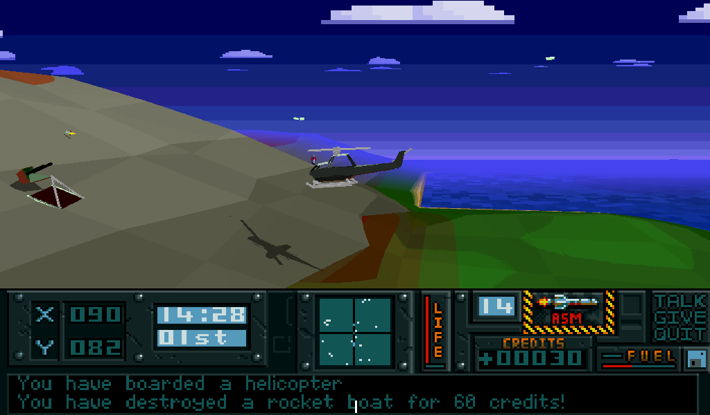
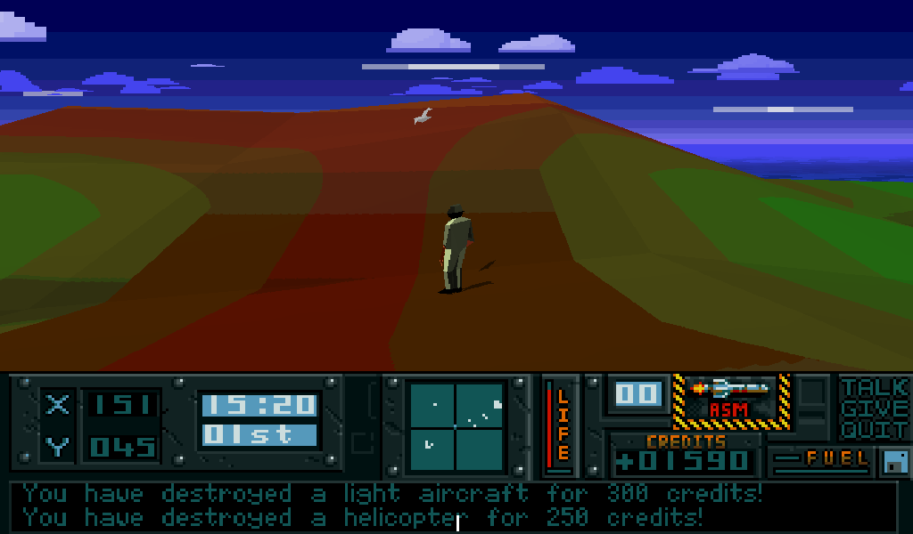

# hunter2

An unofficial remake of Hunter (Activision, 1991, Amiga), written in C# with Godot 4.7.

The game rules are reimplemented from the original program. On top of that it adds a 3D view, smoother animation,
more detailed ground and other changes, each of which can be turned off in the settings menu. With all of them off
it plays like the Amiga version.



 

## Download

Windows builds are on the [Releases](../../releases) page. Unzip and run `hunter2.exe`.

There are no macOS or Linux builds yet.

## Building

Requirements:

- .NET 10 SDK
- Godot 4.7.2, .NET version

```
cd godot
dotnet build
<path to Godot>/Godot_v4.7.2-stable_mono_win64.exe --path .
```

On Windows, `hunter2.bat` does the same if the `GODOT` environment variable points at the Godot executable.

To export a build, open `godot/project.godot` in the Godot editor and use Project > Export (a Windows Desktop preset
is included). Copy `game_data/` next to the exported executable.

## Game data

`game_data/` holds the files the game reads: the original program, models, worlds, pictures, sound and music.
`HUNTER_DATA` can point the game at another folder.

The data can be regenerated from an Amiga disk image of the original game:

```
cd tools
python -m hunterdata.build <path to Disk.1> ../game_data
```

## Controls

- Arrow keys or numeric keypad: move / steer (keypad 0 or right Ctrl fires)
- Gamepad: d-pad or left stick, A fires
- Space: get out of a vehicle (parachute when flying)
- Return: next weapon
- Esc: options screen (resume, re-brief, save/load, quit)
- P: pause
- C, R, L, M, F, A: clock, radar, log book, map marks, flare, drone (when carried)
- Page Up / Page Down: zoom the camera
- Q / E: turn the 3D view
- F2: change key bindings
- Mouse: the panel, item table, map, log book and store

## Settings

The settings menu is grouped into pages:

- Screen: TV look, fullscreen, the 3D view on or off, pixel size, screen shape
- Land and sky: view distance, ground lighting and colours, sky, clouds, sea
- Models: model colours, see-through glass, animation, shadows, explosions
- World: more objects, finer ground, vehicle exit side, bullet size, A500 timing
- Sound: Amiga filter, extra sound effects, voices, smoothed music
- Controls: message log, analog steering, mouse aiming, keys

The release build starts with these changes turned on. A build run from source asks on first start whether to
turn them on.

## Layout

- `rules/` - game rules, world, objects, save files
- `godot/` - window, input, sound, menus
- `godot/real3d/` - the 3D view (shaders and model building)
- `tools/hunterdata/` - reads the original disk into `game_data/`
- `game_data/` - game data

## Credits

Hunter was designed and programmed by Paul Holmes, with music and sound effects by Martin Walker, and published by
Activision in 1991. This project is not affiliated with them.
