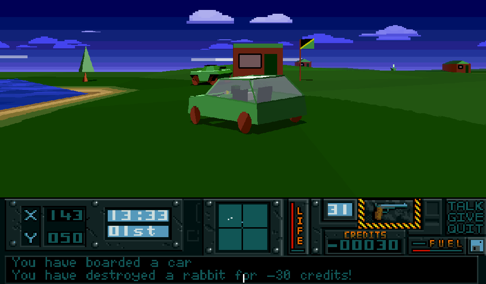
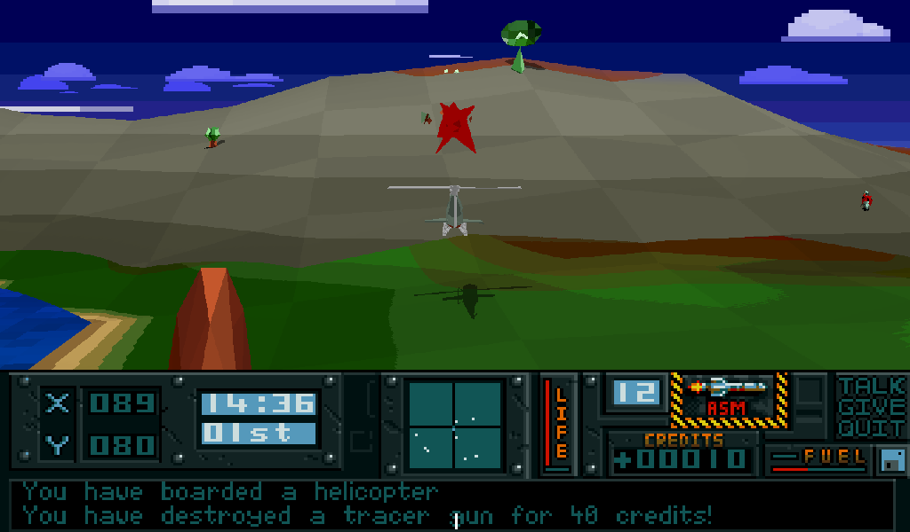
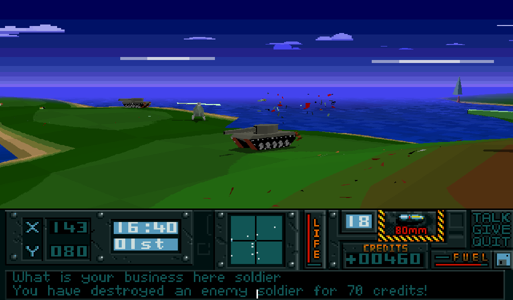
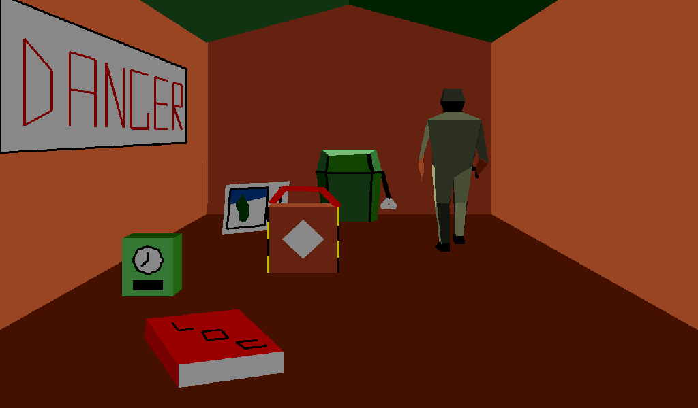
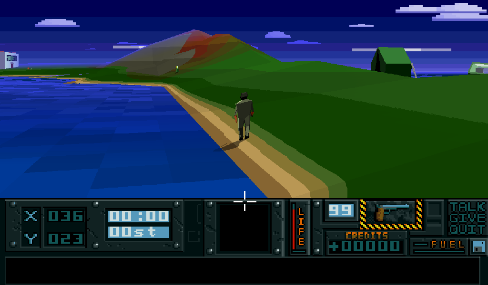

# hunter2

An unofficial remake of Hunter (Activision, 1991, Amiga), written in C# with Godot 4.7 and Claude Code.


 
 
 
 
 

## Features

### Graphics
- Expanded colour palette
- 50 fps
- Free camera rotation (no longer locked facing north)
- Debris and fireball explosions
- Real sun shadows, cast by every object

### World
- Gradient sky, clouds and haze
- Sun, moon and stars
- Finer ground mesh with more colour variation
- Animated sea
- Extended view distance, widescreen

### Models
- Round wheels, rotor masts, animated tank tracks
- Vehicle interiors and see-through glass

### Gameplay
- Game rules and models taken from the original's assembly code and data
- Experimental world mode: more objects on the islands, people and animals that react to each other, graves
- Fixes for several original bugs

### Sound
- More sound channels for effects

### Input
- Gamepad with analog steering
- Rebindable keys

## Controls

- Arrow keys or numeric keypad: move / steer (keypad 0 or right Ctrl fires)
- Gamepad: d-pad or left stick, A fires
- Space: get out of a vehicle (parachute when flying)
- Return: next weapon
- Esc: options screen (resume, re-brief, save/load, quit)
- P: pause
- C, R, L, M, F, A: clock, radar, log book, map marks, flare, drone (when carried)
- Page Up / Page Down: zoom the camera
- Q / E: turn the 3D view
- F2: change key bindings
- Mouse: the panel, item table, map, log book and store

## Settings

The settings menu is grouped into pages:

- Screen: TV look, brightness, fullscreen, text size, the 3D world on or off, pixel size, screen shape, demo camera
  and world
- Land and sky: view distance, ground, sky, sea
- Models: model colours, see-through glass, sharks and subs, animation, shadows, explosions
- World: more objects and a living world, finer ground, ground seed, vehicle exit side, bullet size
- Sound: Amiga filter, extra sound effects and voices
- Controls: message log, pause in background, manual and quit buttons, analog steering, mouse aiming

The release build starts with these changes turned on. A build run from source asks on first start whether to
turn them on.

## Download

Windows, Linux and Mac builds are on the [Releases](../../releases) page.

- Windows: unzip and run `hunter2.exe`.
- Linux (64-bit): unpack and run `./hunter2.x86_64`. It needs a Vulkan graphics driver (any recent card with the usual drivers); nothing else to install.
- Mac: unzip; the first start needs two Terminal commands (see [On a Mac](#on-a-mac)).

## Building

Requirements:

- .NET 10 SDK
- Godot 4.7.2, .NET version

```
cd godot
dotnet build
<path to Godot>/Godot_v4.7.2-stable_mono_win64.exe --path .
```

On Windows, `hunter2.bat` does the same if the `GODOT` environment variable points at the Godot executable.

To export a build, open `godot/project.godot` in the Godot editor and use Project > Export (Windows Desktop, Linux and
macOS presets are included). On Windows and Linux, copy `game_data/` next to the exported program. The macOS export
puts it inside `Hunter.app` by itself (`addons/mac_game_data`).

### On a Mac

The download: macOS refuses to start a free game that is not paid-signed by Apple. Once, after unzipping:

1. Open Terminal, type `cd` and a space, drag the folder that holds `Hunter.app` into the window, press Return.
   This moves Terminal into that folder.
2. `xattr -cr Hunter.app` - removes the "downloaded from the internet" mark that makes macOS block it.
3. `codesign --force --deep -s - Hunter.app` - signs the app again on your own Mac, so macOS lets it run.
4. Double-click `Hunter.app`. From then on it opens normally.

To build it yourself instead:

1. Install the .NET 10 SDK from <https://dotnet.microsoft.com/download/dotnet/10.0> (Arm64 for an M1/M2/M3/M4 Mac,
   x64 for an Intel Mac). In Terminal, `dotnet --version` should then print 10.something.
2. Download `Godot_v4.7.2-stable_mono_macos.universal.zip` from
   <https://github.com/godotengine/godot/releases/tag/4.7.2-stable>, unzip it and move `Godot_mono.app` to
   Applications.
3. Get this repository: `git clone https://github.com/nitre/hunter2.git`, or Code > Download ZIP on this page and unzip
   (the folder is then called `hunter2-main`; use that name below).
4. In Terminal:

   ```
   cd hunter2/godot
   dotnet build
   /Applications/Godot_mono.app/Contents/MacOS/Godot --path .
   ```

   The game starts in a window. Run the last two lines again to start it later.

If macOS says Godot can't be opened, Control-click `Godot_mono.app` in Finder, choose Open, then try step 4 again.

To make your own `Hunter.app` instead:

1. Open the project in the Godot editor: `/Applications/Godot_mono.app/Contents/MacOS/Godot --path . -e`
2. Editor > Manage Export Templates > Download and Install.
3. Project > Export, pick macOS, Export Project, and save it as `Hunter.app`. The game data goes inside it.

## Game data

`game_data/` holds the files the game reads: the original program, models, worlds, pictures, sound and music.
`HUNTER_DATA` can point the game at another folder.

The data can be regenerated from an Amiga disk image of the original game:

```
cd tools
python -m hunterdata.build <path to Disk.1> ../game_data
```

## Layout

- `rules/` - game rules, world, objects, save files
- `godot/` - window, input, sound, menus
- `godot/real3d/` - the 3D view (shaders and model building)
- `tools/hunterdata/` - reads the original disk into `game_data/`
- `game_data/` - game data

## Credits

Hunter was designed and programmed by Paul Holmes, with music and sound effects by Martin Walker, and published by
Activision in 1991. This project is not affiliated with them.
